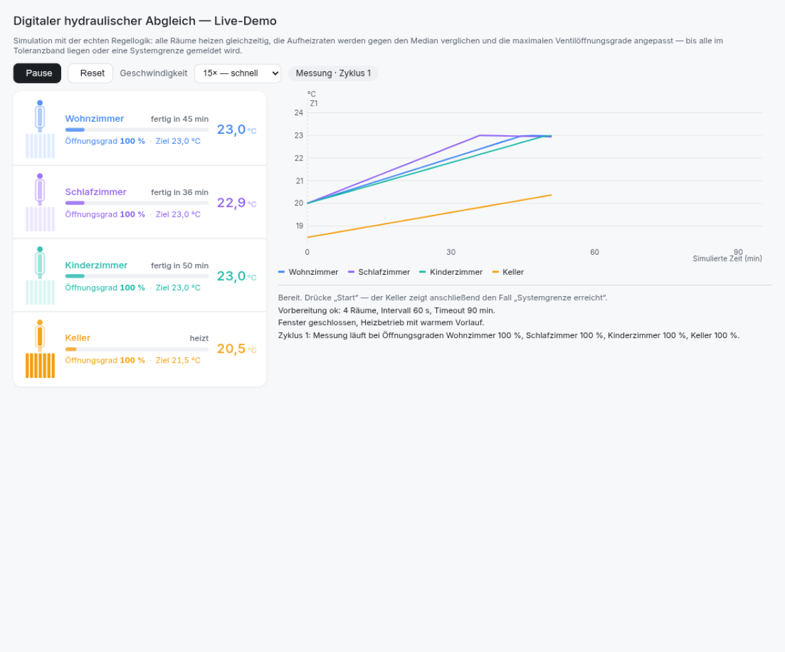
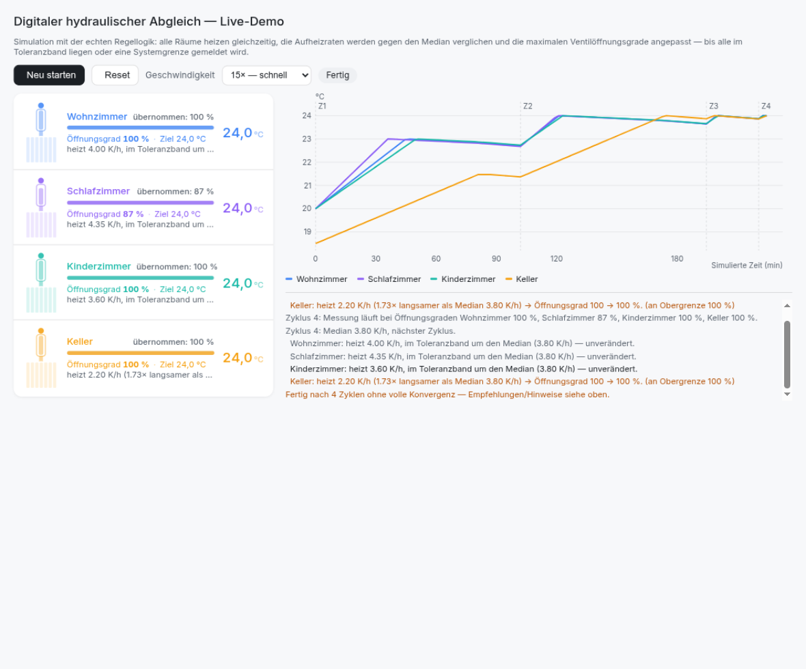
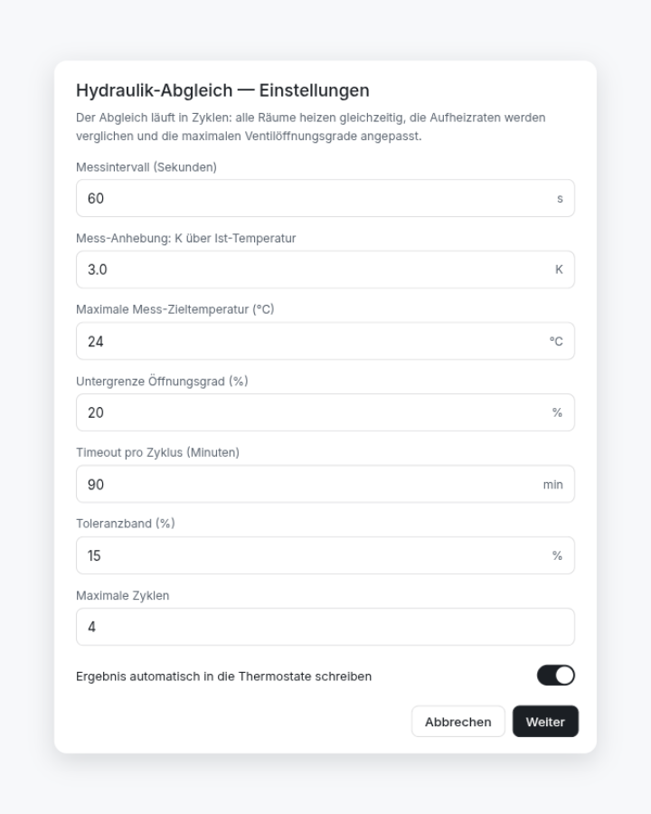
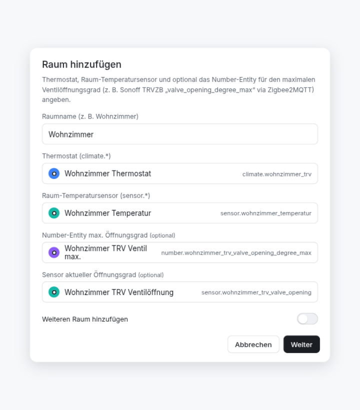

# Hydraulic Balance — digitaler hydraulischer Abgleich für Home Assistant

Vollautomatischer **digitaler hydraulischer Abgleich** für **Zigbee-Thermostate** — selbst entwickelt als Home-Assistant-Custom-Integration. Ziel: alle Räume heizen gleich schnell, ohne dass eine Schraube angefasst werden muss.

Methodik — iteratives Zyklus-Lernen (messen → vergleichen → nachstellen): Die pro-Raum-Mess-Infrastruktur ist inspiriert von [sandreialexandru/Smart-Heating-Control](https://github.com/sandreialexandru/Smart-Heating-Control), ergänzt um die **Anpassung der maximalen Ventilöffnungsgrade** — das eigentliche Herzstück des Abgleichs.

## Wie es funktioniert

Der Abgleich läuft in wiederholten Zyklen:

1. **Messen** — Alle Räume heizen gleichzeitig, jedes Ventil begrenzt auf seinen aktuellen Maximal-Öffnungsgrad (Zyklus 1: 100 %). Die Integration loggt alle 60 s die Raumtemperatur und berechnet pro Raum die **Aufheizrate (K/h)**.
2. **Vergleichen** — Die Raten werden gegen den **Median** aller Räume gerechnet. Wer schneller als das Toleranzband (±15 %) heizt, wird gedrosselt; wer langsamer ist, kriegt mehr Öffnungsgrad (gedämpfte Regelung, max. ±15 Punkte pro Zyklus).
3. **Wiederholen** — 2–5 Zyklen bis alle Räume im Toleranzband liegen. Ergebnis: gleiche Aufheizzeit für alle Räume = digitaler Abgleich.

Pro Anpassung gibt es eine **Begründung im Bericht** („heizt 1,4× schneller als Median → 100 → 85 %"), damit nachvollziehbar bleibt, was das System warum entschieden hat.

### Sicherheitsmechanismen

- Überhitzungsschutz: Raum-Abbruch bei Zielspanne +2 °C, Mess-Ziel ist standardmäßig auf 24 °C gedeckelt
- Timeout pro Zyklus (Standard 90 min) — Räume, die nicht ans Ziel kommen, liefern trotzdem eine Teilrate
- Am Ende jedes Zyklus und bei Abbruch werden alle **Solltemperaturen wiederhergestellt**
- Stop-Service setzt jederzeit zurück (Solltemperaturen + Original-Öffnungsgrade)

## Ein Blick auf die Oberfläche

Die oberen beiden Bilder stammen aus der interaktiven Live-Demo der Regellogik (Simulation mit derselben Mathematik wie die Integration).

| | |
|---|---|
|  |  |
| *Live-Demo: Zyklus 1 — alle Ventile bei 100 %, die Aufheizkurven steigen* | *Live-Demo: Ergebnis — Schlafzimmer auf 87 % geregelt, Keller meldet Systemgrenze* |
|  |  |
| *Einrichtung: Optionen (Intervall, Toleranz, Zyklen …)* | *Einrichtung: Raum mit Thermostat, Sensor & Ventil-Entity* |

## Voraussetzungen

- Home Assistant **2025.1+**
- Zigbee-TRVs, deren **maximaler Öffnungsgrad extern einstellbar** ist — die Integration setzt pro Raum ein `number.*`-Entity:

| Thermostat | Preis (ca.) | Number-Entity | Bemerkung |
|---|---|---|---|
| **Sonoff TRVZB** | ~30 € | `valve_opening_degree_max` (Z2M) | **Empfehlung**: externer Sensor-Anschluss, saubere Z2M-Exposure, häufigste Wahl für solche Projekte |
| Eurotronic Spirit SPZB0001 | ~35 € | `valve_opening_degree` (Z2M-Attribut) | bewährt, etwas älter |
| Moes/BRT-100 (TS0601) | ~20 € | je nach Firmware | billig, aber ungenauere Ventile |

- Pro Raum ein **eigenständiger Temperatur-Sensor** (nicht die TRV-interne Messung — die sitzt zu nah am Heizkörper)
- Heizbetrieb mit warmem Vorlauf während der Messung; geschlossene Fenster

## Installation

### HACS (empfohlen)
1. HACS → Custom repositories → `https://github.com/HatchetMan111/Hydraulischer-Abgleich` (Typ: Integration)
2. Herunterladen, HA neu starten

### Manuell
`custom_components/hydraulic_balance/` nach `<config>/custom_components/` kopieren, HA neu starten.

## Einrichtung

1. **Einstellungen → Geräte & Dienste → Integration hinzufügen → „Hydraulic Balance"**
2. Optionen setzen (Defaults passen für den Anfang: 60-s-Intervall, 3 K Mess-Anhebung, 90-min-Timeout, 4 Zyklen)
3. Pro Raum: Name, Thermostat (`climate.*`), Temperatursensor und — der entscheidende Punkt — das **Number-Entity für den Max-Öffnungsgrad** angeben

> **Ohne Number-Entity geht es auch**: Der Raum wird dann nur gemessen und im Bericht steht die Empfehlung (z. B. „Wohnzimmer: 70 % — manuell setzen oder Rücklaufverschraubung drosseln"). So funktioniert die Integration auch mit TRVs ohne Öffnungsgrad-Kontroll.

## Bedienung

- Service **`hydraulic_balance.start`** — Abgleich starten (Dauer: pro Zyklus typisch 30–90 min, ganzer Abgleich 1–2 Tage über die Heizperiode verteilt)
- Service **`hydraulic_balance.stop`** — abbrechen & zurücksetzen
- Service **`hydraulic_balance.reset_learning`** — Lernwerte auf 100 % zurücksetzen
- Sensoren: Status, pro Raum Heizrate (K/h), Öffnungsgrad-Ziel (%), Status mit Begründung
- Beispiel-Dashboard: [`examples/dashboard.yaml`](examples/dashboard.yaml)

### Bericht lesen

- **konvergiert** → alle Räume innerhalb des Toleranzbands, fertig
- **(an Untergrenze)** → Raum wird am Limit gedrosselt; stärkere Drosselung nur noch manuell an der Rücklaufverschraubung möglich
- **(an Obergrenze 100 %)** → Kreis ist zu schwach versorgt: Rücklaufverschraubung öffnen, entlüften, Heizlast prüfen — das meldet das System, statt endlos weiterzuregeln

## Grenzen (ehrlich)

- Der digitale Abgleich **ersetzt keinen klassischen statischen Abgleich** an den Rücklaufverschraubungen — er optimiert die Verteilung innerhalb der durch die Ventile gegebenen Bandbreite. Bei Fußbodenheizung muss der statische Abgleich stimmen, hier drosselt digital nur Symptome.
- Die Messung nimmt an, dass der Vorlauf während aller Zyklen ähnlich warm ist. Große Wetter-Sprünge zwischen den Zyklen verfälschen den Vergleich → möglichst an aufeinanderfolgenden Tagen laufen lassen.
- `autoset` schreibt die Ergebnisse direkt in die Thermostate. Wer erst prüfen will, schaltet es aus — dann liefert die Integration nur Empfehlungen.

## Tests

```bash
python3 -m pytest tests/ -v
```

Die Kernlogik (`learning.py`) ist bewusst HA-frei und vollständig unit-getestet: Rate-Fitting, Drossel-/Erhöhungsregeln, Schrittlimiten, Konvergenz, Closed-Loop-Simulation über mehrere Zyklen.
